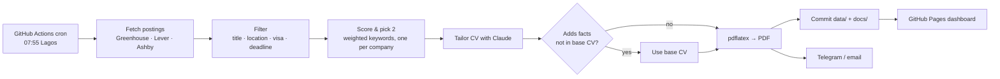

# Two-a-Day

Every morning this finds the two best-fit early-career infrastructure roles from public job boards, tailors a one-page LaTeX CV to each posting with Claude, sends them to you, and keeps a tracker dashboard on GitHub Pages. You still read each posting and submit the application yourself: the goal is two *quality* applications a day, not spam.

It runs entirely on GitHub Actions. There's no server to keep alive and no database: the repo is the database.



## How it decides

| Step | What happens | Where |
| --- | --- | --- |
| Fetch | Pulls every posting from the boards listed under `sources` in `config/profile.yaml`. A board that 404s is skipped with a warning. | `sources.py` |
| Filter | Title must look early-career (`intern`, `graduate`…) and not senior; at least one location must be workable for you; descriptions that require citizenship or rule out sponsorship are dropped; closed deadlines are dropped. | `score.py` |
| Score | Weighted keywords (`site reliability`, `linux`, `kubernetes`…), doubled when they appear in the title, plus a bonus when the deadline is within 14 days. | `score.py` |
| Pick | Highest scores first, at most one role per company, never a role it has already shown you. | `score.py` |
| Tailor | Claude or Gemini may reorder and reword bullets using the posting's language. | `tailor.py` |
| Guard | Any number, acronym or capitalised term in the tailored CV that isn't in `cv/base.tex` (a new metric, a cert you don't hold) throws the draft away and sends the base CV. A CV that spills onto page two is also replaced. | `tailor.py`, `cli.py` |
| Publish | `data/apps.json` and `docs/` are committed back; Pages serves `docs/index.html` and the PDFs under `docs/cvs/`. | `store.py`, `site.py` |

## Deploy it (about 10 minutes)

1. Push this folder to a new GitHub repo, e.g. `Slay1der/two-a-day`. **Make the repo private** if you don't want your CV PDFs public (Pages on a private repo needs GitHub Pro, which is free with the GitHub Student Developer Pack).
2. **Settings → Pages → Source: GitHub Actions.**
3. **Settings → Secrets and variables → Actions → New repository secret:**

   | Secret | Needed? | What it does |
   | --- | --- | --- |
   | `CV_PHONE`, `CV_EMAIL` | Yes | Your real phone and email. The committed `cv/base.tex` only holds placeholders, so the repo can stay public; these are swapped in when the CVs are built. |
   | `GEMINI_API_KEY` | Optional (free) | Tailors each CV using Gemini's free tier. Get a key at aistudio.google.com → Get API key. Two calls a day is far inside the free limits. |
   | `ANTHROPIC_API_KEY` | Optional | Tailors each CV with Claude instead (used first if both are set). Get one at console.anthropic.com. |
   | `TELEGRAM_BOT_TOKEN`, `TELEGRAM_CHAT_ID` | Optional | Sends the picks and PDFs to Telegram. Create a bot with @BotFather; get your chat id from @userinfobot. |
   | `SMTP_USER`, `SMTP_PASSWORD`, `NOTIFY_EMAIL` | Optional | Emails the picks. For Gmail, use an App Password, not your normal password. |

4. **Actions → Daily picks → Run workflow** to try it now. After that it runs by itself every morning.

When you've applied: **Actions → Update status**, paste the key from the dashboard, pick `Applied`. The dashboard and your streak update.

## Run it locally

```bash
python -m venv .venv && source .venv/bin/activate
pip install -e ".[dev]"
twoaday run --dry-run          # just print today's picks
twoaday run --no-pdf           # pick + record, skip LaTeX
twoaday list                   # everything you've tracked
twoaday status e9e39e5f Applied
pytest -q && ruff check .
```

Or with Docker (LaTeX included):

```bash
docker build -t twoaday .
docker run --rm -e ANTHROPIC_API_KEY -v "$PWD/data:/app/data" -v "$PWD/docs:/app/docs" twoaday run
```

## Make it yours

- **Your CV:** edit `cv/base.tex`. It's the only source of truth the tailor is allowed to draw from. Keep the placeholder phone and email in it; the real ones come from the `CV_PHONE` / `CV_EMAIL` secrets.
- **What counts as a fit:** `config/profile.yaml`: keywords and weights, allowed locations, title rules, deal-breaker phrases.
- **Where it looks:** add companies under `sources`. The board name is the last part of the company's careers URL: `boards.greenhouse.io/<name>`, `jobs.lever.co/<name>`, `jobs.ashbyhq.com/<name>`.
- **Model:** set `GEMINI_MODEL` or `TWOADAY_MODEL` (Claude) to change the model. If Google renames its models, update `GEMINI_MODEL` to one listed in AI Studio.

## Your turn

Three things to build yourself. Each is small and touches a different part of the code. Hints only:

1. **A fourth source.** Many companies use Workable (`apply.workable.com/<name>`). Add `parse_workable` next to the other parsers, register it in `FETCHERS`, and write a fixture test like `test_sources.py`. Hint: find the JSON endpoint by opening a Workable careers page with your browser's Network tab open.
2. **Smarter "seen".** Right now a role is only skipped if you've been shown its exact URL. Companies often repost the same job with a new URL. How would you change `Job.key` so a repost doesn't come back, and what could go wrong if you make it too loose?
3. **A health check.** If every source fails one morning (an API change, an outage), the run "succeeds" with zero picks and nobody notices. Make the workflow fail loudly when fewer than half the sources answered. That's an SLO for your own pipeline, and a good story for an SRE interview.
